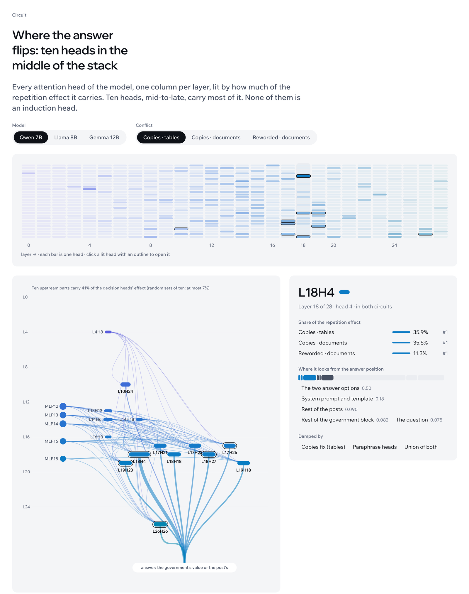

# Repetition Beats Credibility: How Language Models Let Reworded Claims Outvote Official Sources

Interactive companion: https://lefrenchnewslab.github.io/repetition-beats-credibility/

<a href="https://lefrenchnewslab.github.io/repetition-beats-credibility/#circuit">
  <picture>
    <source media="(prefers-color-scheme: dark)" srcset="figs/circuit_explorer_dark.png">
    
  </picture>
</a>

<sub>Every attention head of Qwen2.5-7B, lit by its share of the repetition effect. Ten heads around layers 17 to 19 settle the answer, fed mostly by mid-layer MLPs. Click the image to explore it.</sub>

Code, generated data and every number for the paper by Amr Sobhy (Le French News Lab), written at the Apart Research AI x Epistemics Research Sprint, November 2026. Paper: [`paper.pdf`](paper.pdf).

## Summary
We test whether a low-credibility claim that is repeated next to a credible one overrides it, in four open language models (Llama-3.1-8B, Qwen2.5-7B, Gemma-3-12B, Qwen2.5-32B), on fictional conflicts between a government source and a social-media user, in tables, news snippets and retrieved documents. We compare exact copies, paraphrased copies and independent users, locate the attention heads that carry the effect with patching on held-out entities, test with reviewer-requested controls whether the paraphrase effect is repetition rather than wording and whether those heads are specific to the conflict, probe whether credibility is still represented, and test two fixes on the same model: training-free head damping and a trained LoRA adapter. **Headline:** in retrieved documents, four paraphrased copies of one post flip 86% of Qwen2.5-32B's answers to the social-media value, against 3% for four exact copies, while one paraphrased copy barely moves the answer. The same ten heads carry credibility-driven answer changes too, so repetition and credibility compete in the same place; neither fix separates copies from independent sources.

| Result (test entities) | Value [95% CI] | Paper | Source key |
|---|---|---|---|
| Qwen2.5-32B, documents: items flipped by 4 paraphrased / 4 exact copies | 85.5% / 2.75% | Abstract, §4.2 | `numbers_A.json` `Qwen-32B.F3.test.C7k4.flip_pct`, `…C2k4.flip_pct` |
| Same, paraphrased minus exact, P(low-credibility value) | +60.3 points [58.3, 62.2] | §4.2 | `Qwen-32B.F3.test.C7k4_minus_C2k4_pts` |
| Top-10 heads recover the repetition effect (tables): Llama / Qwen-7B / Gemma | 91.9% / 95.4% / 93.1% | §4.3, Fig. 4 | `<model>.F1.patch.top10.recovery_pct` |
| Block F (F1): paraphrase gain minus exact-copy gain D, documents, Qwen2.5-32B / Qwen2.5-7B (pre-registered, both supported); one paraphrased copy alone, Qwen2.5-32B | +59.1 [57.1, 61.1] / +30.2 [28.3, 32.2]; +1.2 [0.9, 1.5] points | §4.2, Tables 2, 18 | `numbers_F.json` `F1.<model>.F3.D_pts`, `F1.Qwen-32B.F3.W_pts` |
| Block F (F2): same top-10 heads, tables, on a repeated government source (C1→C6): Llama / Qwen-7B / Gemma; specific to the conflict (pre-registered) | 92.8% / 96.6% / 93.7%; not met in any model | §4.3, Tables 2, 19 | `F2.<model>.C1k1->C6k4.recovery_top10_pct`, `F2.<model>.specific` |
| Head damping, Qwen2.5-7B tables: exact-copy effect removed; source preference kept | 54% [52, 57]; 80% [77, 82] | §4.5 | `numbers_B.json` `B3.F1.F1.BR_C2k4`, `B3.F1.F1.pref_kept` |
| LoRA adapter, Qwen2.5-7B documents: paraphrase effect removed; independent-user effect kept | 95% [94, 96]; 2% [1, 4] | §4.5, Fig. 6 | `numbers_D.json` `D.F3.BR_C7k4`, `D.F3.corrob_kept` |

## Repository map
Start with `reproduce.py`.

| Path | Purpose |
|---|---|
| `reproduce.py` | **Start here.** Rebuilds every paper table, figure and number from the committed outputs (CPU, offline, ~1-2 min) and runs the number check |
| `paper.pdf` | The paper |
| `paper/main.tex`, `paper/refs.bib` | Paper source; `number_check.py` reads `main.tex` to check every hand-typed number |
| `paper/app_prereg.tex`, `paper/app_tables.tex`, `paper/app_extra.tex` | Appendices A and B as in the paper, generated by `scripts/make_appendix.py` |
| `numbers_A.json`, `numbers_B.json`, `numbers_D.json`, `numbers_F.json` | Every reported number for Blocks A, B, D and F: `key -> {value, ci, n, source}` |
| `numbers_F_posthoc.json` | Block F per-template paraphrase numbers, added post hoc (labelled as such in `docs/RESULTS_F.md`) |
| `figs/` | The data figures in the paper (PDF + PNG): `fig0_headline` (Fig. 1, made by `scripts/fig_intro.py`), `fig1_dose_response` (Fig. 3), `fig2_head_recovery` (Fig. 4), `fig5_c1only_flipped_by_layer` (Fig. 5), `figD_tradeoff_F3` (Fig. 6, made by `scripts/fig_tradeoff.py`; the drafts written by `analyze_d.py` and `polish_figs.py` under the same name still show a point from another paper and are overwritten), `figB3_tradeoff_F3` (not in the paper). Fig. 2 (pipeline) is drawn in `paper/main.tex` |
| `data/prompts_v2.jsonl.gz` | Main prompt set: 120,000 prompts (600 pairs × 3 formats × conditions × 8 variants) |
| `data/prompts_graded.jsonl.gz`, `prompts_neutral.jsonl.gz`, `prompts_f3selC7.jsonl.gz`, `prompts_c6.jsonl.gz` | Probe control sets (graded credibility 4,000; neutral tags 3,200), F3 paraphrase selection prompts (1,600), C6 test prompts (6,400) |
| `data/pairs_v2.jsonl` | The 600 fictional conflicts (entity, attribute, two values, sources, users) |
| `data/manifest_v2.json` | Counts, overlap checks and the SHA-256 of `prompts_v2.jsonl` |
| `data/examples_v2.md` | One full example prompt per format and condition |
| `data/pilot_pairs.jsonl` | Fictional pilot entities; read only by `build_data_v2.py` to exclude every pilot word from the sprint data |
| `data/prompts_f.jsonl.gz`, `data/manifest_f.json` | Block F prompts (32,000, test entities): one paraphrased copy per template (C7 k=1), four users each paraphrased (C8 k=4), length-matched filler (C5p), in tables and documents; SHA-256 in the manifest |
| `data/train_d.jsonl`, `data/val_d.jsonl`, `data/manifest_d.json` | Block D LoRA training (1,500) and validation (300) items on new fictional entities; counts, overlap checks, SHA-256 |
| `results/A/` | Block A outputs: per-prompt behaviour (`behaviour_*.jsonl.gz`), probes, probe directions, patching, controls (`extras_*`), run metadata, `summary_A.md` |
| `results/B/` | Block B outputs (Qwen2.5-7B): induction check (`b0_*`), path patching (`b1_*`), steering (`b2_*`), damping fix selection/test/capability/curves (`b3_*`), `summary_B.md` |
| `results/B/llama/`, `results/B/gemma/` | Damping-fix replications on Llama-3.1-8B and Gemma-3-12B |
| `results/F/` | Block F: behaviour on the new conditions in documents (`behaviour_*.jsonl.gz`, 4 models) and tables (`f1/`, 3 models), fixed-head patching on four contrasts (`f2_patch_*.json`), `summary_F.md`. Chosen-answer probe AUCs are in `results/A/probe_c1chosen_*.json` |
| `results/D/` | Block D (LoRA): per-prompt test outputs, capability, training logs per learning rate (`lr*/train_log.json`), the chosen checkpoint, `summary_D.md` |
| `scripts/build_data_v2.py`, `scripts/build_data_d.py` | Generate all prompt files (CPU, deterministic) |
| `scripts/run_v2.py` | GPU: behaviour, hidden states, probes, controls and attribution/activation patching (Block A) |
| `scripts/probe_c1only.py` | CPU: C1-only and decision-balanced credibility probes on saved hidden states; also writes the steering directions `runs/A/dirs_c1only_<model>.npz` used by `B2` (job 165426) |
| `scripts/pick_best.py` | Picks the model for the F3 head analysis (highest F1 held-out recovery) |
| `scripts/b0_induction.py`, `scripts/b1_path.py`, `scripts/run_b2.py`, `scripts/run_b3.py` | GPU, Block B: induction-head scores, path patching, steering, head-damping fix (`run_b3.py --lora` also scores the Block D adapter) |
| `scripts/build_data_f.py`, `scripts/f2_patch.py` | Block F: build the new prompts (CPU; asserts the shared conditions are byte-identical to `prompts_v2.jsonl`); GPU patching of the fixed Block A head sets on four contrasts. Block F behaviour uses `run_v2.py behave --data data/prompts_f.jsonl --nohidden`; `probe_c1only.py --chosen` adds the chosen-answer AUCs |
| `scripts/train_lora.py`, `scripts/pick_lora.py` | GPU, Block D: train the LoRA adapter; choose learning rate and checkpoint by validation loss |
| `scripts/lexical_ngram.py`, `scripts/analyze_v2.py`, `scripts/analyze_b.py`, `scripts/figs_b.py`, `scripts/analyze_d.py`, `scripts/analyze_f.py`, `scripts/posthoc_f1_templates.py` | CPU analysis: tables, numbers files and draft figures for each block |
| `scripts/polish_figs.py`, `scripts/fig_intro.py`, `scripts/fig_tradeoff.py`, `scripts/make_appendix.py`, `scripts/number_check.py` | Print versions of the figures, appendix tables, and the check of every number in the main text |
| `scripts/sprintA.slurm`, `scripts/cpu_probe.slurm`, `scripts/submit_chain.sh`, `scripts/chain_tail.sh` | Slurm wrappers used on the cluster (set `$WORK_ROOT` and `<account>`) |
| `scripts/cmds/*.txt` | The exact command list of each Slurm job, one file per job, named as in `docs/JOBS.md` |
| `docs/RESULTS_A.md`, `docs/RESULTS_B.md`, `docs/RESULTS_D.md`, `docs/RESULTS_F.md` | Pre-registrations (written before the data they test), dated amendments and results for each block |
| `docs/FAILURE_MODES.md` | Failure modes and mitigations, written before the code |
| `docs/JOBS.md` | Every GPU/CPU job: job id, what it ran, elapsed time, A100-hours |
| `requirements.txt`, `requirements-gpu.txt` | Pinned Python packages for the analysis and for a full GPU rerun |
| `LICENSE`, `LICENSE-DATA` | MIT (code), CC BY 4.0 (data, outputs, documents) |
| `.gitignore` | Keeps `reproduced/`, `runs/`, decompressed files and OS files out of git |

## Requirements
- **Quickstart (analysis only):** Python 3.13 (the version tested), `pip install -r requirements.txt` (numpy, scipy, scikit-learn, matplotlib, pinned). No GPU, no network, no API keys.
- **Full rerun:** `pip install -r requirements-gpu.txt` (adds PyTorch 2.8.0, transformers 4.55.4, peft 0.17.1, datasets 4.0.0, accelerate 1.10.1; we used the Jean Zay module `pytorch-gpu/py3/2.8.0`), one NVIDIA A100 80 GB, Slurm, and Hugging Face access to `meta-llama/Llama-3.1-8B-Instruct`, `Qwen/Qwen2.5-7B-Instruct`, `google/gemma-3-12b-it` and `Qwen/Qwen2.5-32B-Instruct`. No API models are used.

## Compute
| Stage | Hardware | A100-hours | Notes (`docs/JOBS.md`) |
|---|---|---|---|
| Pilot (before the sprint, feasibility only; no reported number) | 1× A100 80 GB | ≈ 1.3 | not in this repository |
| Block A: behaviour, probes, patching (4 models) | 1× A100 80 GB | 9.65 | Qwen2.5-32B behaviour 1.36 A100-h; + ~16 CPU core-hours for probes |
| Block B: induction check, path patching, steering, damping fix + replications | 1× A100 80 GB | 8.56 | + ~2 CPU core-hours |
| Block D: LoRA baseline (2 learning rates, 3 checkpoints each, test + capability) | 1× A100 80 GB | 2.00 | |
| Block F: reviewer controls (new-condition behaviour, 4 models; fixed-head patching, 3 models) | 1× A100 80 GB | 2.36 | + ~2 CPU core-hours for the chosen-answer probe AUCs |
| **Total** | | **≈ 23.9** (sprint experiments ≈ 22.6) | |
| Analysis (`reproduce.py`) | laptop CPU | — | ~4 min |

## Quickstart: reproduce the paper (CPU, ~4 min, offline)
```bash
git clone https://github.com/lefrenchnewslab/repetition-beats-credibility && cd repetition-beats-credibility
pip install -r requirements.txt
python3 reproduce.py               # add --check-data to also regenerate the prompt files and compare SHA-256 (+30 s)
```
It decompresses the committed outputs into a temporary directory, reruns every analysis script, checks that the regenerated `numbers_A/B/D/F.json`, `numbers_F_posthoc.json` and appendix tables equal the committed ones, runs `scripts/number_check.py` against `paper/main.tex`, and writes `reproduced/` (numbers, figures, appendix `.tex`, block summaries, `NUMBER_CHECK.md`). It took about 3.5 minutes on one CPU core (Python 3.13; `analyze_f.py` alone takes ~70 s). You should see:

```
  numbers_A.json: 823 keys regenerated, 0 differ from the committed file
  numbers_B.json: 84 keys regenerated, 0 differ from the committed file
  numbers_D.json: 96 keys regenerated, 0 differ from the committed file
  numbers_F.json: 273 keys regenerated, 0 differ from the committed file
  numbers_F_posthoc.json: 56 keys regenerated, 0 differ from the committed file
  paper/app_prereg.tex: identical to the committed file
  paper/app_tables.tex: identical to the committed file
  paper/app_extra.tex: identical to the committed file
  Abstract, Sec. 4.2   Qwen2.5-32B, documents: items flipped by 4 paraphrased copies (%)      85.5
  Abstract, Sec. 4.2   Qwen2.5-32B, documents: items flipped by 4 exact copies (%)            2.75
  Sec. 4.2             Qwen2.5-32B, documents: paraphrased minus exact (points)               60.3 [58.3, 62.2]
  Sec. 4.3, Fig. 4     Llama-8B: top-10 heads recover, tables (%)                             91.9 [90.4, 93.4]
  Sec. 4.3, Fig. 4     Qwen-7B: top-10 heads recover, tables (%)                              95.4 [92.3, 99.0]
  Sec. 4.3, Fig. 4     Gemma-12B: top-10 heads recover, tables (%)                            93.1 [91.2, 95.2]
  Sec. 4.2 (Block F)   Qwen-32B, documents: paraphrase gain minus exact-copy gain D (points)  59.1 [57.1, 61.1]
  Sec. 4.2 (Block F)   Qwen-7B, documents: paraphrase gain minus exact-copy gain D (points)   30.2 [28.3, 32.2]
  Sec. 4.2 (Block F)   Qwen2.5-32B, documents: one paraphrased copy, wording effect W (points) 1.2 [0.9, 1.5]
  Sec. 4.3 (Block F)   Llama-8B: top-10 heads recover, tables, C1->C6 government repeated (%) 92.8 [91.5, 94.0]
  Sec. 4.3 (Block F)   Qwen-7B: top-10 heads recover, tables, C1->C6 government repeated (%)  96.6 [92.3, 101.5]
  Sec. 4.3 (Block F)   Gemma-12B: top-10 heads recover, tables, C1->C6 government repeated (%) 93.7 [91.7, 95.7]
  Sec. 4.5             Head damping (Qwen2.5-7B, tables): exact-copy effect removed (%)       54.3 [51.6, 57.1]
  Sec. 4.5             Head damping: source preference kept (%)                               79.6 [76.9, 82.1]
  Sec. 4.5, Fig. 6     LoRA (Qwen2.5-7B, documents): paraphrase effect removed (%)            94.6 [93.6, 95.6]
  Sec. 4.5             LoRA, documents: independent-user effect kept (%)                      2.2 [0.7, 3.6]
number_check: 101 claims; 101 pass; 0 fail
reproduce.py: OK
```

| Paper item | Script (run by `reproduce.py`) | Output |
|---|---|---|
| Table 1, Figs. 1 and 3-5, §4.1-4.4 numbers, Tables 6-12 | `analyze_v2.py` (+ `lexical_ngram.py`), `polish_figs.py`, `fig_intro.py` | `numbers_A.json`, `results/A/summary_A.md` |
| Tables 13-17, appendix trade-off figure, §4.3 path patching, §4.4 steering, §4.5 damping | `analyze_b.py` (Qwen, Llama, Gemma), `figs_b.py`, `polish_figs.py` | `numbers_B.json`, `results/B/summary_B.md` |
| §4.5 LoRA, Fig. 6 | `analyze_d.py`, then `fig_tradeoff.py` (runs last) | `numbers_D.json`, `results/D/summary_D.md`, `figD_tradeoff_F3` |
| §4.2 single-copy and filler controls, §4.3 credibility/government contrasts, Table 2 rows P1-P2, Tables 4, 18, 19 | `analyze_f.py`, `posthoc_f1_templates.py` | `numbers_F.json`, `numbers_F_posthoc.json`, `results/F/summary_F.md` |
| Appendix Tables 3-24 (typeset; Table 13 includes the LoRA rows, Tables 20-21 the example item, Tables 22-24 the headline metrics, template sensitivity and block order), LoRA training and prompt examples | `make_appendix.py` | `paper/app_prereg.tex`, `paper/app_tables.tex`, `paper/app_extra.tex` |
| Every hand-typed number in the main text | `number_check.py` | `NUMBER_CHECK.md` |

The probe fits (H3-H5) are rerun only in the full rerun, because they need the saved hidden states (tens of GB, not released); the quickstart uses their committed outputs (`results/A/probe*_*.json`).

## Full rerun from scratch (GPU, ≈ 20 A100-hours)
1. **Data** (CPU, ~15 s; deterministic, seeds 20261113 and 20261114):
   ```bash
   python3 scripts/build_data_v2.py data      # prompts_v2/graded/neutral/f3selC7/c6, pairs, manifest
   python3 scripts/build_data_d.py            # train_d, val_d, manifest_d
   sha256sum data/prompts_v2.jsonl            # must equal prompts_sha256 in data/manifest_v2.json
   ```
2. **Working directory.** The GPU scripts read `data/` next to themselves, as on the cluster:
   ```bash
   W=$WORK_ROOT/sprint_A; mkdir -p $W/logs $W/runs/A $W/runs/B $W/runs/D $W/data_cap
   cp scripts/*.py scripts/*.sh scripts/*.slurm $W/ && cp -r scripts/cmds $W/ && cp -r data $W/
   ```
   Save the capability datasets with `datasets.save_to_disk` (capability checks in `run_b3.py`): MMLU = Hugging Face `cais/mmlu`, config `all`, split `test` (14,042 items; 500 sampled with `random.Random(0)`, indices stored in `results/B/b3_cap_F1_Qwen2.5-7B-Instruct.json`, `mmlu_idx`) → `$W/data_cap/mmlu_test`; WikiText-103 = `Salesforce/wikitext`, config `wikitext-103-raw-v1`, split `test` (4,358 rows; the first 200 non-heading paragraphs with ≥ 50 tokens, truncated to 256) → `$W/data_cap/wikitext103_test`:
   ```python
   from datasets import load_dataset
   load_dataset("cais/mmlu", "all", split="test").save_to_disk("data_cap/mmlu_test")
   load_dataset("Salesforce/wikitext", "wikitext-103-raw-v1", split="test").save_to_disk("data_cap/wikitext103_test")
   ```
3. **GPU jobs**, one at a time, in the order of `docs/JOBS.md`: `cd $W && CMDS=cmds/<file>.txt sbatch --qos=<qos> --time=02:00:00 sprintA.slurm` (set your account in `sprintA.slurm`).
   - Block A (9.2 A100-h): `A01` then `bash submit_chain.sh <A01 job id>`, which chains `A02`-`A09` and, through `chain_tail.sh`, `A10`-`A11`. CPU probes (amendments 6-10): `TAGS="<model tags>" [PARGS=--balanced] sbatch cpu_probe.slurm`. The unbalanced run (no `PARGS`) also writes `runs/A/dirs_c1only_<model>.npz`, which `B2` needs (job 165426 reran it for all three models for that purpose).
   - Block B (8.6 A100-h): `B0`, `B3a`, `B3a2`, `B3b`, `B3c`, `B3d`, `B3d2`, `B3e`, `B2`, `B3R1`, `B3R2`, `B3R3`, `B1`. Copy `runs/A/patch_*`, `behaviour_*` and `probe_dirs_*` where the command files expect them (paths are in each file).
   - Block D (2 A100-h): `D1`, `D2`, `D3` (`D0` is a 4-minute smoke test).
   - Block F (2.4 A100-h): first `python3 scripts/build_data_f.py` (CPU, writes `data/prompts_f.jsonl` + `manifest_f.json`), then `FJ1_f1main`, `FJ2_f2_and_f3expl`, `FJ3_f1tables`. `f2_patch.py` reads the Block A head sets `runs/A/patch_F1_<model>.json` and behaviour `runs/A/behaviour_<model>.jsonl`. Chosen-answer AUCs: `TAGS="<model tags>" PARGS=--chosen sbatch cpu_probe.slurm` (needs the saved Block A hidden states).
4. **Analysis:** copy the run outputs into `results/A`, `results/B`, `results/D`, `results/F` (`runs/F/f2_patch_*` and behaviour; gzip the `.jsonl` files) and run `python3 reproduce.py`.

Every selection step (heads, probe layers, damping strength, LoRA checkpoint) uses the 200 selection entities or the LoRA validation entities; every reported number uses the 400 held-out test entities. Model scoring is deterministic (bf16 forward passes, no sampling); bootstrap CIs use `numpy.random.default_rng(0)` with 2,000 resamples over pairs. LoRA training uses seed 42 (one seed). Reruns on other GPUs or library versions can differ in the last digits of bf16 logits.

**Not in the repository:** saved hidden states and model checkpoints (tens of GB; regenerated by the GPU jobs), the LoRA adapter weights (regenerated by `D2`; the chosen checkpoint is `lr1e-4/ckpt_e2`), Slurm logs, the MMLU/WikiText copies (public datasets), and the pilot code.

## Data
All entities, places, organisations and users are **fictional**, generated by `scripts/build_data_v2.py` (sprint data) and `scripts/build_data_d.py` (LoRA training data) from hand-written templates; no model or LLM wrote any prompt, and no real person or organisation is described. Generation is deterministic: rerunning the scripts reproduces every file byte for byte (`reproduce.py --check-data` checks this; `prompts_v2.jsonl` SHA-256 `a0a3836d…f0f16b75bf4` in `manifest_v2.json`). The 600 conflicts are split by entity into 200 selection and 400 test entities with zero shared names or words, and share no word with the pilot data (`manifest_v2.json`, `overlap_*`). The LoRA data uses 300 new entities (250 training, 50 validation), with zero overlap with the sprint and pilot data (`manifest_d.json`).

Each prompt line holds the format (`fmt`: F1 table, F2 news snippet, F3 retrieved documents), `pair_id`, `split`, condition (`cond` C0-C7, `k` copies), the counterbalancing fields (`lowidx`, `order`, `ans`, `letter_low`), the `system` and `user` text, and token `spans`. Each behaviour line in `results/*/` holds the prompt id and fields plus `p_low` (renormalised probability of the low-credibility value), `mass` (A+B probability) and `ld` (logit difference). Conditions are defined in the paper (§3.1) and in `docs/RESULTS_A.md`.

## Provenance
Code to test the feasibility of this idea was written before the sprint; all experiments reported here were run during the sprint.

| File | Status |
|---|---|
| `scripts/build_data_v2.py`, `scripts/run_v2.py`, `scripts/sprintA.slurm` | Derived from the pilot code (11 Nov 2026) and modified in the sprint (13-14 Nov); changes are listed in `docs/RESULTS_A.md` (amendments) |
| All other files in `scripts/` and `reproduce.py` | New, written in the sprint (13-14 Nov 2026; Block F scripts 14 Nov) |
| Data, results, numbers files, figures | Generated in the sprint; new seed and new entities, zero overlap with the pilot (`data/manifest_v2.json`) |
| `data/pilot_pairs.jsonl` | Pilot data (11 Nov 2026), included only for the word-exclusion check |

The prompt format and scoring follow Schuster et al., "Whose Facts Win?" (arXiv 2601.03746), and `train_lora.py` follows the objective and settings of their `finetuning/train.py`; their code is not included here.

## Licence
Code (`scripts/`, `reproduce.py`): MIT, see `LICENSE`. Data, model outputs, figures, documents and the paper: CC BY 4.0, see `LICENSE-DATA`. The models used keep their own licences.

## Citation
```bibtex
@misc{sobhy2026repetition,
  title  = {Repetition Beats Credibility: How Language Models Let Reworded Claims Outvote Official Sources},
  author = {Sobhy, Amr},
  year   = {2026},
  note   = {AI x Epistemics Research Sprint, Apart Research},
  url    = {https://github.com/lefrenchnewslab/repetition-beats-credibility}
}
```

## Contact
Amr Sobhy, Le French News Lab · GitHub [@amrsobhy](https://github.com/amrsobhy) · please report errors as GitHub issues.

## Acknowledgements
This work was granted access to the HPC resources of IDRIS under the allocation 2026-AD011018247 made by GENCI.
